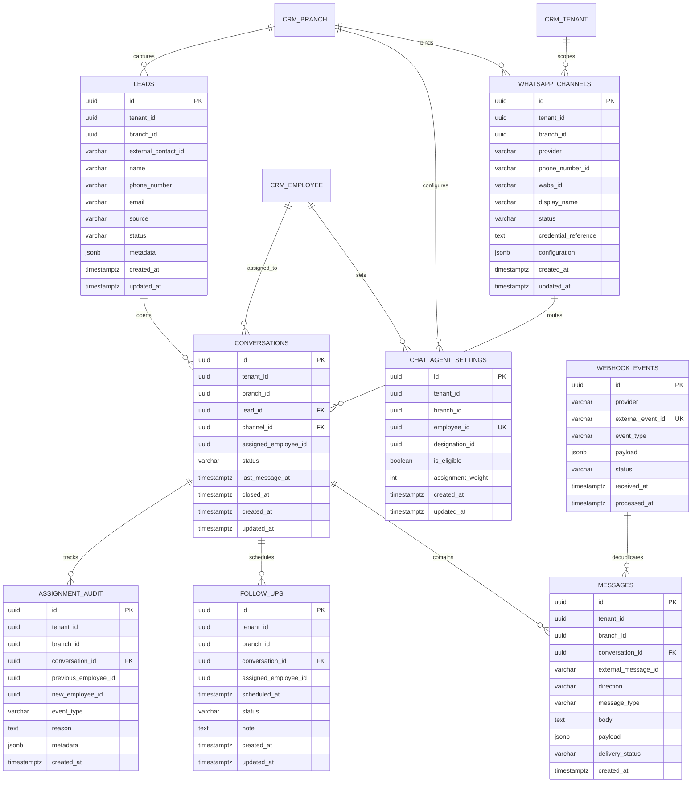

# Database Design: Supabase PostgreSQL Persistence Layer

## 1. Executive Architecture Overview

The database layer for the `gym-whatsapp-helpdesk` system is built on PostgreSQL managed via Supabase. It provides persistent storage for all helpdesk operational state—channels, leads, conversations, messages, follow-ups, agent settings, and audit logs—while strictly preserving the **CRM as the sole source of truth** for tenant, branch, employee, and designation master records.

### Guiding Architectural Principles:
1. **CRM Authority Preservation:** The helpdesk database never creates duplicate master tables for tenants, branches, or employees. It references CRM UUIDs and enforces referential integrity through application validation layers (`helpdesk.service.ts` + `ICrmAdapter`).
2. **Multi-Tenant Composite Keys:** Database relationships enforce tenant and branch alignment via composite unique constraints and composite foreign keys `(tenant_id, branch_id, ...)`.
3. **Fail-Closed Reliability:** If Supabase credentials are missing or the database connection fails, the application throws an explicit `DatabaseConfigurationError` (HTTP 503). In-memory fallbacks are prohibited.
4. **Row-Level Security (RLS):** All 11 tables enforce RLS with tenant isolation policies and service-role bypass.
5. **Auditing & Immutability:** Assignment audits and message payloads are append-only. Triggers prevent unauthorized updates to historical audit records.

---

## 2. Entity-Relationship Diagram (ERD)



---

## 3. Database Tables & Key Specifications

| Table Name | Primary Purpose | Key Constraints |
|:---|:---|:---|
| `whatsapp_channels` | Provisioned WhatsApp business accounts per branch | Unique `(provider, phone_number_id)` |
| `chat_designations` | Helpdesk-specific chat roles (mapped to CRM) | Check status `active/inactive` |
| `chat_agent_settings` | Agent eligibility & routing weight per branch | Unique `(tenant_id, employee_id)` |
| `chat_assignment_rules`| Distribution strategy per tenant/branch | Check strategy `round_robin/weighted/etc.` |
| `chat_assignment_state`| Runtime pointer for round-robin routing | Unique `(tenant_id, branch_id)` |
| `leads` | Inbound contacts & prospect tracking | Composite key `(tenant_id, branch_id, id)` |
| `conversations` | Threaded customer support sessions | Composite FK referencing `leads(tenant_id, branch_id, id)` |
| `messages` | Inbound/outbound chat messages | Composite FK referencing `conversations(tenant_id, branch_id, id)` |
| `follow_ups` | Scheduled reminders and tasks for agents | Check status `scheduled/completed/cancelled/overdue` |
| `assignment_audit` | Append-only audit trail for chat reassignments | Trigger-enforced immutability |
| `webhook_events` | Idempotent ledger for incoming webhook events | Unique `(provider, external_event_id)` |

---

## 4. Multi-Tenant Integrity & Isolation Safeguards

### Composite Foreign Key Enforcement
To prevent cross-tenant and cross-branch data corruption, child tables utilize composite foreign keys:
```sql
ALTER TABLE conversations
  ADD CONSTRAINT fk_conversations_lead_scope
  FOREIGN KEY (tenant_id, branch_id, lead_id)
  REFERENCES leads (tenant_id, branch_id, id)
  ON DELETE RESTRICT;

ALTER TABLE messages
  ADD CONSTRAINT fk_messages_conversation_scope
  FOREIGN KEY (tenant_id, branch_id, conversation_id)
  REFERENCES conversations (tenant_id, branch_id, id)
  ON DELETE CASCADE;
```
This guarantees that a conversation cannot point to a lead belonging to a different branch or tenant, even if direct SQL injection were attempted.

### Row-Level Security (RLS)
Every table has `ALTER TABLE <table_name> ENABLE ROW LEVEL SECURITY;` enabled. Policies enforce tenant isolation:
```sql
CREATE POLICY "tenant_isolation_conversations" ON conversations
  FOR ALL
  USING (
    auth.role() = 'service_role' OR
    tenant_id = NULLIF(current_setting('app.current_tenant_id', true), '')::uuid
  );
```

### Immutable Audit Trigger
```sql
CREATE OR REPLACE FUNCTION prevent_assignment_audit_modification()
RETURNS TRIGGER AS $$
BEGIN
  RAISE EXCEPTION 'assignment_audit records are strictly append-only and cannot be updated or deleted';
END;
$$ LANGUAGE plpgsql;

CREATE TRIGGER trg_assignment_audit_immutable
BEFORE UPDATE OR DELETE ON assignment_audit
FOR EACH ROW EXECUTE FUNCTION prevent_assignment_audit_modification();
```

---

## 5. Staging Environment Runbook

### Prerequisites
- Supabase Project URL (`https://<project-ref>.supabase.co`)
- Service Role Secret Key (`SUPABASE_SERVICE_ROLE_KEY`)

### Applying Migrations
Execute migrations in lexicographical order:
```bash
# Using Supabase CLI:
supabase db push

# Or via direct psql connection:
psql "$DATABASE_URL" -f supabase/migrations/20261017000001_create_core_helpdesk_tables.sql
psql "$DATABASE_URL" -f supabase/migrations/20261017000002_add_constraints_and_indexes.sql
psql "$DATABASE_URL" -f supabase/migrations/20261017000003_configure_rls_and_triggers.sql
```

### Seeding Test Fixtures
Seed deterministic, repeatable staging records:
```bash
psql "$DATABASE_URL" -f supabase/seed.sql
```
The seed script uses `ON CONFLICT DO NOTHING` across all 11 tables, ensuring safe and idempotent reruns without primary key conflicts.

### Verification Queries
```sql
-- Verify 11 tables exist
SELECT count(*) FROM information_schema.tables WHERE table_schema = 'public';

-- Check seed counts
SELECT 'leads' as table_name, count(*) FROM leads
UNION ALL
SELECT 'conversations', count(*) FROM conversations
UNION ALL
SELECT 'messages', count(*) FROM messages;
```
